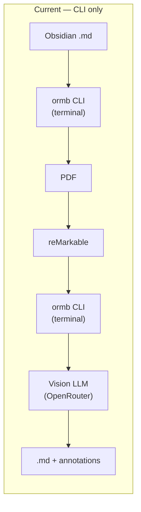
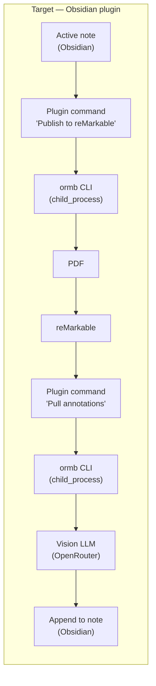
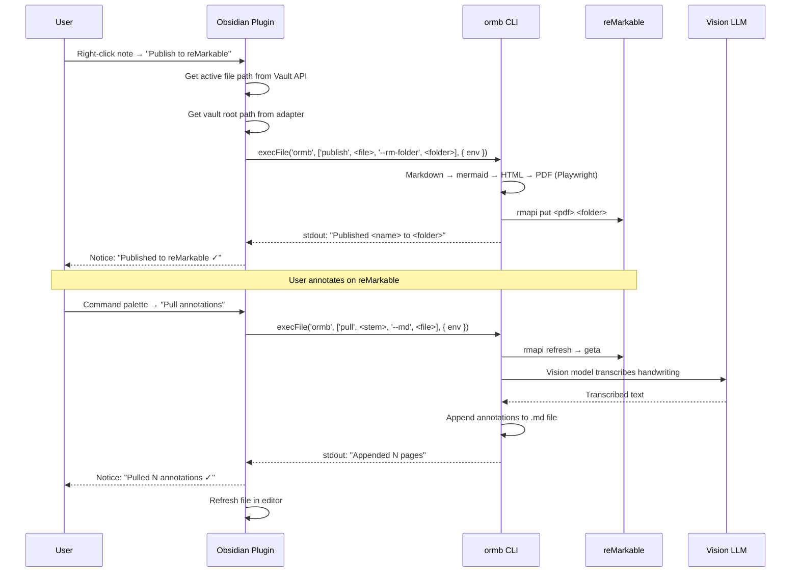

# ARB — Obsidian Plugin for reMarkable Bridge

> Architecture Review Brief — 2026-11-12
> Status: **Draft** — pending operator approval

## Business Outcome

**Problem:** No existing Obsidian↔reMarkable tool transcribes handwritten annotations back into markdown. Three plugins exist — all one-directional or marks-only.

**Why now:** The `ormb` CLI (v0.1.0) is built, E2E tested, and open-sourced. The hard part (vision LLM transcription of handwriting) is proven. The thin Obsidian plugin wraps it.

**What good looks like:** A user installs the plugin, pairs their reMarkable, publishes a note, annotates by hand, and pulls transcribed annotations back — all from the Obsidian UI. No terminal. No Python knowledge. No CLI.

## Current State



- `ormb` CLI v0.1.0: 94 tests, lint clean, E2E verified on WSL
- 29 files, 2,818 lines, MIT license
- Requires: Python 3.10+, rmapi binary, Playwright Chromium, OpenRouter key (pull only)
- Cross-platform: Mac, Windows, Linux (all rmapi assets verified)

## Target State



The plugin is a **thin TypeScript wrapper** around `ormb`. All heavy lifting (PDF rendering, rmapi, vision transcription) stays in the CLI. The plugin provides:

1. **Obsidian UI integration** — ribbon icon, command palette, status notices
2. **Settings management** — OpenRouter key, reMarkable folder, vision model (stored in Obsidian settings, passed to ormb via env vars)
3. **Vault context** — auto-detects vault path from Obsidian's `Vault` API, no manual config

## Architecture

### Plugin Structure

```
obsidian-rm-bridge-plugin/
├── manifest.json          # Obsidian plugin manifest
├── src/
│   ├── main.ts           # Plugin entry point — extends Plugin
│   ├── settings.ts        # Settings tab — extends PluginSettingTab
│   ├── commands.ts        # Command registrations
│   ├── ormb-runner.ts     # child_process wrapper for ormb CLI
│   └── types.ts           # TypeScript interfaces
├── esbuild.config.mjs     # Build config (esbuild → main.js)
├── package.json
├── tsconfig.json
└── styles.css             # Ribbon icon, status bar
```

### How It Works

Obsidian runs on **Electron**, which exposes Node.js APIs. The plugin uses `child_process.execFile('ormb', [...args])` to call the CLI.

| Component | Responsibility |
|-----------|---------------|
| `main.ts` | Plugin lifecycle, register commands + ribbon icon |
| `settings.ts` | Settings UI (OpenRouter key, reMarkable folder, vision model, ormb path) |
| `commands.ts` | 5 commands: Publish, Pull, Pull --all, Pair, Setup |
| `ormb-runner.ts` | `execFile('ormb', args, { env: { OPENROUTER_API_KEY: ... } })` — captures stdout/stderr, returns Promise |

### Commands

| Command | Trigger | ormb call |
|---------|---------|-----------|
| Publish to reMarkable | Command palette / ribbon icon | `ormb publish <active-file>` |
| Pull annotations | Command palette / ribbon icon | `ormb pull <file-stem> --md <active-file>` |
| Pull all annotations | Command palette | `ormb pull --all` |
| Pair with reMarkable | Settings tab button | `ormb pair` (interactive — shows code input modal) |
| Setup ormb | Settings tab button | `ormb setup --rmapi && ormb setup` |

### Settings

```typescript
interface RmBridgeSettings {
  openrouterApiKey: string;      // stored in Obsidian settings
  remarkableFolder: string;       // default: "/Obsidian"
  visionModel: string;           // default: "z-ai/glm-4.5v"
  ormbPath: string;              // default: "ormb" (PATH lookup)
  autoPublishOnSave: boolean;     // default: false
}
```

Vault path is **auto-detected** from `app.vault.adapter.getBasePath()` — no manual config needed.

### Data Flow



## Competitive Landscape

| Plugin | Approach | Handwriting? | Round-trip? | API key? |
|---------|----------|:---:|:---:|:---:|
| **reMarkable Round-Trip** (maxonamission) | Geometric stroke→word mapping | No — marks only | Yes | No |
| **reMarkable Bridge** (kebl3541) | Desktop app local store, Type Folio | No — typed text only | Yes (text) | No |
| **obsidian-remarkable-sync** (dsebastien) | Cloud integration, sync as images | No | One-way | No |
| **ours (obsidian-rm-bridge)** | Vision LLM transcription | **Yes** | **Yes** | OpenRouter |

**Our moat:** Vision LLM transcription of actual handwritten annotations. The others handle marks (strikethrough, bold, highlight) or typed text — none transcribe freehand handwriting back into editable markdown.

## Cross-Platform Installation

### Prerequisites (all platforms)

| Dependency | Purpose |
|------------|---------|
| Python 3.10+ | `ormb` CLI runtime |
| `ormb` CLI | `pip install obsidian-rm-bridge` (or from source) |
| rmapi binary | `ormb setup --rmapi` downloads it |
| Playwright Chromium | `ormb setup` installs it |
| OpenRouter API key | Required for annotation transcription (pull only) |
| Obsidian plugin | Manual install (later: community plugin store) |

### macOS

```bash
# 1. Install ormb CLI
brew install python
python3 -m venv ~/.venvs/ormb && source ~/.venvs/ormb/bin/activate
pip install obsidian-rm-bridge
ormb setup --rmapi
ormb setup

# 2. Pair with reMarkable
ormb pair

# 3. Install Obsidian plugin
# Download latest release → <vault>/.obsidian/plugins/obsidian-rm-bridge/
# Settings → Community plugins → enable
```

### Windows

```powershell
# 1. Install ormb CLI
python -m venv %USERPROFILE%\.venvs\ormb
%USERPROFILE%\.venvs\ormb\Scripts\activate
pip install obsidian-rm-bridge
ormb setup --rmapi
ormb setup

# 2. Pair with reMarkable
ormb pair

# 3. Install Obsidian plugin
# Download latest release → <vault>\.obsidian\plugins\obsidian-rm-bridge\
# Settings → Community plugins → enable
```

### Linux / WSL

```bash
# 1. Install ormb CLI
sudo apt install python3 python3-pip python3-venv python3.10-venv
python3 -m venv .venv && source .venv/bin/activate
pip install obsidian-rm-bridge
ormb setup --rmapi
ormb setup          # installs Chromium + system libs (sudo)

# 2. Pair with reMarkable
ormb pair

# 3. Install Obsidian plugin
# Download latest release → <vault>/.obsidian/plugins/obsidian-rm-bridge/
# Settings → Community plugins → enable
```

## Delivery Plan

### Phase 5a: Plugin scaffold + publish command

1. Create `obsidian-rm-bridge-plugin` repo (or monorepo subfolder)
2. `manifest.json`, `package.json`, `esbuild.config.mjs`, `tsconfig.json`
3. `main.ts` — Plugin class, ribbon icon, command registration
4. `ormb-runner.ts` — `child_process.execFile` wrapper with Promise API
5. "Publish to reMarkable" command — publish active note
6. Settings tab — OpenRouter key, reMarkable folder, ormb path
7. Build + manual install in vault → E2E test

### Phase 5b: Pull command + status feedback

8. "Pull annotations" command — pull for active note
9. "Pull all annotations" command
10. Pair command (interactive modal for one-time code)
11. Setup command (run `ormb setup --rmapi && ormb setup` from plugin)
12. Status bar with publish/pull progress
13. E2E test: publish → annotate on reMarkable → pull → verify annotations in vault

### Phase 5c: Polish + release

14. Error handling (ormb not found, rmapi not paired, API key missing, Playwright not installed)
15. Settings validation + helpful error messages
16. README with screenshots
17. GitHub release (main.js + manifest.json + styles.css as zip)
18. Submit to Obsidian community plugin store

### Phase 5d: PyPI release (optional, later)

19. `pyproject.toml` → PyPI publish (`pip install obsidian-rm-bridge`)
20. Plugin auto-detects `ormb` in PATH, falls back to `pip install` instructions

## Design Decisions

| Decision | Choice | Rationale |
|----------|--------|-----------|
| Plugin architecture | **Thin TS wrapper** around `ormb` CLI | CLI is built, tested, E2E proven. No need to port PDF/mermaid/vision to Node. |
| PDF rendering | **Playwright (in ormb)** | Already in the CLI. No Node/Electron PDF dependency in the plugin. |
| Vision LLM | **OpenRouter (hard requirement)** | Vision transcription is the differentiator. Users who want it sign up for OpenRouter. Open source = PRs for other providers. |
| Vault path | **Auto-detected from Obsidian** | No manual config. `app.vault.adapter.getBasePath()`. |
| API key storage | **Obsidian settings** | Encrypted at rest by Obsidian. Passed to ormb via `OPENROUTER_API_KEY` env var. |
| Distribution | **GitHub releases → community store** | Manual zip install first, community plugin store after review. |

## Risks

| Risk | Likelihood | Mitigation |
|------|-----------|------------|
| `ormb` not in PATH | Medium | Settings tab has "ormb path" field + "Install ormb" button |
| Playwright Chromium download on first use | Medium | `ormb setup` handles it; plugin shows progress notice |
| OpenRouter key friction | Medium | Hard requirement for pull. Publish works without it. Document clearly. |
| Obsidian plugin review process | Low | Follow obsidianmd/obsidian-releases submission guidelines |
| Electron child_process permissions | Low | Confirmed: obsidian-api README says `require('child_process')` is available |

## What We're NOT Building (Yet)

- **Full TypeScript port** — no reason until the CLI has traction. The thin wrapper ships in days, a full port is weeks.
- **Mobile support** — Obsidian mobile doesn't expose Node.js APIs. The CLI requires a desktop OS.
- **Marks-only mode** — the geometric stroke mapping (reMarkable Round-Trip's approach) is a different product. Ours is handwriting transcription.
- **rmfakecloud support** — ormb uses rmapi which supports it, but the plugin doesn't expose it yet.