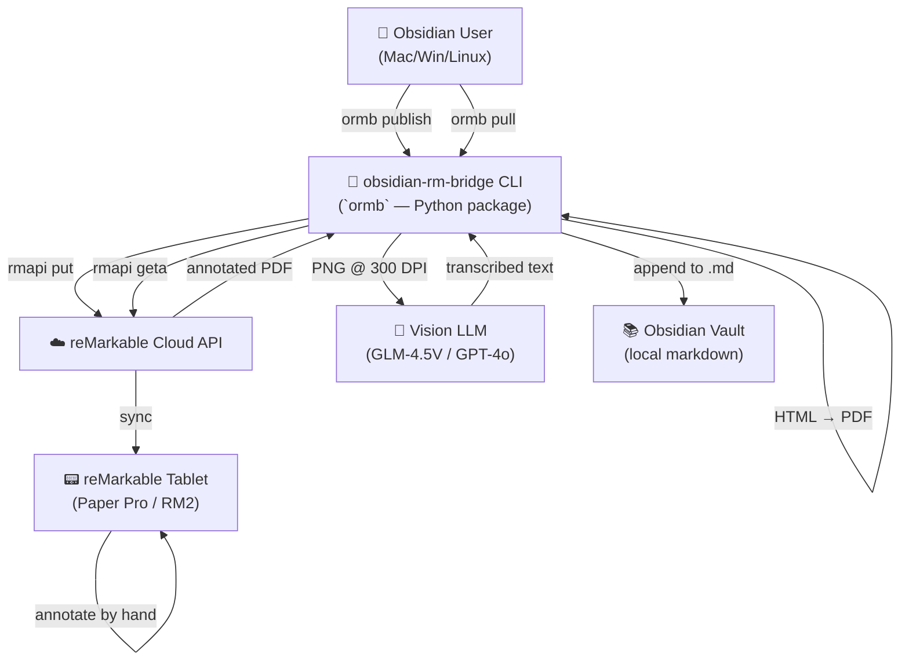
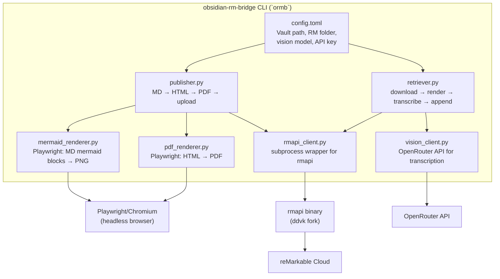
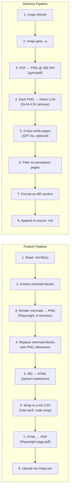
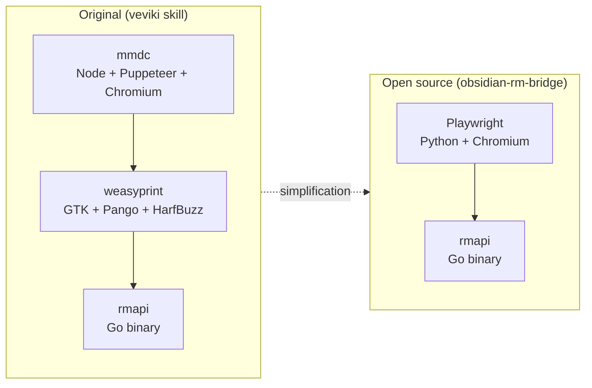

# obsidian-rm-bridge — Architecture & Delivery Plan

> **Status:** Phase 5a — Plugin scaffold + publish command shipped (T-WSL). Phase 5b next.
> **Author:** vevmesteren
> **Date:** 2026-11-13
> **Repo:** [vevmesteren/obsidian-rm-bridge](https://github.com/vevmesteren/obsidian-rm-bridge)

---

## 1. Lineage

This project is the open-source extraction of the **veviki-remarkable-bridge** — a Hermes Agent skill that has been in daily use since Phase 1 (proven PoC, 2026-11-12). The original skill lives at `~/.hermes/profiles/vevmesteren/skills/productivity/veviki-remarkable-bridge/` and is tightly coupled to the veviki knowledge base and the Hermes host environment.

### Provenance

| Phase | Date | Status | Deliverable |
|-------|------|--------|-------------|
| Phase 1 | 2026-11-12 | ✅ Done | `publish.py` — markdown → PDF → reMarkable upload (PoC) |
| Phase 2 | 2026-11-12 | ✅ Done | `retrieve.py` — annotation round-trip via GLM-4.5V vision |
| Phase 3 | 2026-11-12 | ✅ Done | Polish: tests, CSS e-ink styling, folder publish, re-upload handling |
| **Phase 4** | **2026-11-12** | **✅ Done** | **Open source extraction — this document** |
| **Phase 5** | **2026-11-13** | **In Progress** | **Obsidian TypeScript plugin (thin wrapper over CLI)** |

### What's Proven

- **Publish flow:** markdown → mermaid render → HTML → PDF → rmapi upload. Works for single pages and folders.
- **Retrieve flow:** rmapi refresh → geta → pymupdf 300 DPI render → GLM-4.5V transcription → append to source .md. Cross-verified with GPT-4o.
- **Real usage:** Published `craft-anything-integration-plan.md` to reMarkable, annotated it, pulled annotations back via vision model.

### What's Coupled (Must Decouple)

| Coupling | Current State | Target State |
|----------|---------------|--------------|
| reMarkable folder | Hardcoded `/Wiki` | Configurable, default `/Obsidian` |
| Env/API key path | `~/.hermes/profiles/vevmesteren/.env` | Standard `~/.obsidian-rm-bridge/.env` or env var |
| Vault path | Implicit veviki paths | CLI argument or config file |
| Vision model | Hardcoded `z-ai/glm-4.5v` | Configurable, default GLM-4.5V |
| PDF engine | weasyprint (GTK/Pango dependency) | **Playwright** (cross-platform, eliminates mmdc too) |
| Mermaid render | mmdc CLI (Node + Puppeteer/Chromium) | **Playwright** (renders mermaid in-browser) |
| Tool name | "veviki-remarkable-bridge" | `obsidian-rm-bridge` (CLI: `ormb`) |
| Distribution | Hermes skill files | pip installable package, GitHub release |

---

## 2. Competitive Landscape

| Project | Direction | Tech | Round-trip? | Active? |
|---------|-----------|------|-------------|---------|
| `dsebastien/obsidian-remarkable-sync` | reMarkable → Obsidian (images) | TypeScript plugin | ❌ one-way | Moderate |
| `TimDommett/Remarkable-Sync` | reMarkable → Obsidian (PDF) | TypeScript + .rm parser | ❌ one-way | Active |
| Scrybble | reMarkable → Obsidian (sync) | Plugin | ❌ one-way | Active |
| **obsidian-rm-bridge** | **Obsidian → reMarkable → Obsidian** | **Python CLI** | **✅ round-trip** | **New** |

**Differentiator:** We are the only project that does the full round-trip — publish to reMarkable, annotate by hand, pull handwriting back into the vault as structured text via vision LLM. Every existing project is one-directional (reMarkable → Obsidian).

---

## 3. Architecture

### C4 Level 1 — System Context



### C4 Level 2 — Container Diagram



### C4 Level 3 — Component Detail



### Key Architectural Decision: Playwright over weasyprint + mmdc

**Problem:** The original pipeline used weasyprint (HTML→PDF) and mmdc (mermaid→PNG). weasyprint requires GTK/Pango system libraries. On Windows, this means MSYS2 + MSYS2 package manager + GTK DLLs on PATH — the official docs themselves warn "read this chapter carefully." mmdc requires Node.js + Puppeteer + Chromium download. Two heavy dependencies with fragile Windows installs.

**Solution:** Replace both with Playwright. Playwright:
- Downloads its own Chromium binary via `pip install playwright && playwright install` — works identically on Mac, Windows, and Linux
- Can render mermaid diagrams in-browser (load mermaid.js, inject diagram, screenshot)
- Can produce PDFs via `page.pdf()` — no GTK needed
- Is actively maintained by Microsoft, with excellent cross-platform support

**Trade-off:** ~280MB Chromium download vs weasyprint's lighter footprint. For a personal tool used by Obsidian + reMarkable users (who already manage large file libraries), this is negligible. The install simplicity is worth every megabyte.



**Dependency reduction:** 3 system-level deps → 2 (Playwright + rmapi). rmapi has pre-built binaries for all platforms.

---

## 4. Module Structure

```
obsidian-rm-bridge/
├── docs/
│   ├── ARCHITECTURE.md          # This document
│   └── LINEAGE.md               # Provenance and history
├── obsidian_rm_bridge/          # Python package
│   ├── __init__.py
│   ├── cli.py                   # Click/Typer CLI entry point (`ormb`)
│   ├── config.py                # Config loading (TOML + env vars)
│   ├── publisher.py             # Publish pipeline (MD → PDF → upload)
│   ├── retriever.py             # Retrieve pipeline (download → transcribe → append)
│   ├── mermaid_renderer.py      # Playwright-based mermaid → PNG
│   ├── pdf_renderer.py          # Playwright-based HTML → PDF
│   ├── rmapi_client.py          # rmapi subprocess wrapper
│   ├── vision_client.py         # OpenRouter vision API client
│   ├── css.py                   # E-ink readable CSS (embedded)
│   └── utils.py                 # Shared helpers (path resolution, etc.)
├── tests/
│   ├── test_publisher.py
│   ├── test_retriever.py
│   ├── test_mermaid_renderer.py
│   ├── test_pdf_renderer.py
│   ├── test_rmapi_client.py
│   ├── test_vision_client.py
│   └── test_config.py
├── scripts/
│   └── install_rmapi.sh         # Platform-aware rmapi installer
├── pyproject.toml                # Package config (pip install -e .)
├── README.md
└── LICENSE
```

### Module Responsibilities

| Module | Responsibility | Key Change from Original |
|--------|---------------|-------------------------|
| `cli.py` | Entry point, argument parsing, command dispatch | NEW — replaces `if __name__` blocks |
| `config.py` | Load config from `~/.obsidian-rm-bridge/config.toml` + env vars | NEW — replaces hardcoded constants |
| `publisher.py` | Orchestrate publish flow | Refactored from `publish.py` — injectable renderers |
| `retriever.py` | Orchestrate retrieve flow | Refactored from `retrieve.py` — injectable clients |
| `mermaid_renderer.py` | Render mermaid blocks to PNG via Playwright | NEW — replaces mmdc subprocess |
| `pdf_renderer.py` | Convert HTML to PDF via Playwright | NEW — replaces weasyprint |
| `rmapi_client.py` | All rmapi operations (put, geta, refresh, ls, rm, mkdir) | Extracted from inline subprocess calls |
| `vision_client.py` | Send PNG to vision LLM, parse response | Refactored — configurable model + provider |
| `css.py` | Embedded e-ink CSS stylesheet | Extracted from inline string |

---

## 5. Cross-Platform Installation

### Prerequisites

| Dependency | Mac | Windows | Linux |
|------------|-----|---------|-------|
| Python 3.10+ | `brew install python` | Microsoft Store / python.org | `apt install python3 python3-pip` |
| Playwright | `pip install obsidian-rm-bridge` (auto) | Same | Same |
| Chromium | `playwright install` (auto, post-install) | Same | Same + `playwright install-deps` |
| rmapi | `brew install rmapi` or download binary | Download from releases | Download from releases |

### Installation (Target User Experience)

```bash
# 1. Install the package
pip install obsidian-rm-bridge

# 2. Install Playwright browser (one-time)
ormb setup

# 3. Install rmapi (one-time)
ormb setup --rmapi

# 4. Pair reMarkable (one-time)
ormb pair

# 5. Configure
ormb config set vault_path ~/my-obsidian-vault
ormb config set rm_folder /Obsidian
ormb config set vision_model z-ai/glm-4.5v
ormb config set openrouter_api_key sk-or-v1-xxx
```

### Platform-Specific Notes

**macOS:**
- Python via Homebrew or python.org
- Playwright Chromium installs cleanly
- rmapi: `brew install rmapi` (if formula exists) or download `rmapi-darwin-amd64.tar.gz`/`rmapi-darwin-arm64.tar.gz` from ddvk/rmapi releases

**Windows (native + WSL):**
- Python from python.org (3.10+)
- Playwright Chromium installs cleanly (no GTK/MSYS2 needed — this is the whole point of the swap)
- rmapi: download `rmapi-windows-amd64.zip` from ddvk/rmapi releases, add to PATH
- WSL is an alternative path — full Linux install inside WSL, same instructions as Linux
- Both paths work; native Python is simpler for non-technical users

**Linux:**
- Python via system package manager
- Playwright Chromium: may need `playwright install-deps` for system libraries
- rmapi: download `rmapi-linux-amd64.tar.gz`, `sudo mv rmapi /usr/local/bin/`

---

## 6. CLI Interface

```bash
# Publish
ormb publish <path-to-md>              # Single page → PDF → reMarkable
ormb publish <path-to-folder> --folder  # All .md files → combined PDF → reMarkable
ormb publish <path-to-md> --json       # JSON envelope on stdout (plugin-facing)
ormb publish <path-to-md> --vault <root>  # Explicit vault root (containment-checked)
ormb publish <path-to-md> --on-exists fail|content-only  # Don't destroy annotations

# Retrieve
ormb pull <page-name>                   # Download + transcribe + append
ormb pull <page-name> --emit json       # Return sections without writing to disk
ormb pull <page-name> --json            # JSON envelope on stdout
ormb pull --all                          # Pull all annotated pages from /<rm_folder>

# Configuration
ormb config set <key> <value>
ormb config set-key                      # Set API key from stdin (not in argv)
ormb config show
ormb config init                         # Write default config to disk

# Health check
ormb doctor                              # Human-readable health check
ormb doctor --json                       # JSON health check (plugin-facing)

# Setup
ormb setup                               # Install Playwright browser
ormb setup --rmapi                       # Download + install rmapi binary
ormb pair                                # Pair with reMarkable (prompts for code)

# Utilities
ormb ls                                  # List files on reMarkable
ormb rm <page-name>                     # Delete file on reMarkable
```

---

## 7. Configuration Schema

```toml
# ~/.obsidian-rm-bridge/config.toml

[vault]
path = "~/Documents/Obsidian"    # Default vault path

[remarkable]
folder = "/Obsidian"              # reMarkable destination folder

[vision]
model = "z-ai/glm-4.5v"          # Primary transcription model
cross_verify_model = "gpt-4o"    # Optional second model for verification
openrouter_api_key = ""           # Or set OPENROUTER_API_KEY env var

[pdf]
font_size = 14                    # Body font size (pt)
font_family = "Georgia"           # Body font family
code_font_size = 12               # Code block font size (pt)
```

Environment variables override config file:
- `ORB_VAULT_PATH`
- `ORB_RM_FOLDER`
- `ORB_VISION_MODEL`
- `OPENROUTER_API_KEY`

---

## 8. Delivery Plan

### Epic: Open Source CLI (`obsidian-rm-bridge` v0.1.0)

| # | Task | Scope | Dependencies | Est. |
|---|------|-------|-------------|------|
| 1 | **Scaffold repo structure** | `pyproject.toml`, package layout, CLI skeleton, config module | None | 1h |
| 2 | **Port publisher** | Refactor `publish.py` → `publisher.py` + `mermaid_renderer.py` + `pdf_renderer.py` with Playwright | #1 | 3h |
| 3 | **Port retriever** | Refactor `retrieve.py` → `retriever.py` + `vision_client.py` with configurable model | #1 | 2h |
| 4 | **rmapi_client** | Extract all rmapi subprocess calls into clean client module | #1 | 1h |
| 5 | **Config system** | TOML config + env var overrides + `ormb config` commands | #1 | 2h |
| 6 | **CLI commands** | `ormb publish`, `ormb pull`, `ormb setup`, `ormb pair`, `ormb ls`, `ormb rm` | #2,#3,#4,#5 | 2h |
| 7 | **Tests** | Port and adapt tests for new module structure, mock Playwright/rmapi | #2,#3,#4,#5 | 3h |
| 8 | **README + install docs** | Mac/Win/Linux installation, quickstart, config docs | #6 | 2h |
| 9 | **CI workflow** | GitHub Actions: lint (ruff), test (pytest), build check on push | #7 | 1h |
| 10 | **Release v0.1.0** | Tag, GitHub release with notes, PyPI publish (optional) | #8,#9 | 1h |

**Total estimate:** ~18h of focused work. Delegated to vevlivery via kanban card.

### Delivery Model

- **Builder:** vevlivery (kanban dispatch)
- **Reviewer:** vevmesteren (cold review subagent)
- **Done criteria:** All tests pass, `ormb publish` and `ormb pull` work end-to-end on a fresh clone, README install instructions verified on at least Linux (Hermes host), CLI produces correct PDF with mermaid rendering
- **Branch:** `feat/v0.1.0-cli` → PR → cold review → merge to main

### Phase 5 — Obsidian Plugin (shipped 5a)

The TypeScript Obsidian plugin is a thin wrapper around the `ormb` CLI:

- **Plugin scaffold** (`plugin/`): `manifest.json` (`isDesktopOnly: true`), esbuild build, TypeScript strict
- **WSL adapter** (`wsl-adapter.ts`): `wsl.exe --exec` argv-only (no shell, no `bash -c`, no `cmd.exe`), `WSL_UTF8=1`, `PYTHONIOENCODING=utf-8`, `windowsHide: true`
- **Path translation** (`path-translate.ts`): `winToWsl` — translates Windows vault root to WSL path, rejects control chars/UNC/non-drive formats
- **Publish command** (`main.ts`): command palette + ribbon + file-menu, single-flight lock, saves dirty editor, spawns `ormb publish --json`, shows Notice
- **Settings tab** (`settings.ts`): launcher picker, distro, pythonBin, rmFolder, visionModel — **NO API key field** (secrets stay in CLI's 0600 config)
- **Doctor on load**: surfaces warnings (rmapi missing, not paired, key missing, Chromium missing)
- **CI grep ban**: `exec(`, `execSync(`, `shell: true`, `bash -c`, `cmd.exe /c` banned in `plugin/src/`

**Primary topology:** T-WSL (Obsidian on Windows, ormb CLI in WSL2). T-MAC, T-LINUX, T-WIN deferred to Phase 5c.

---

## 9. Design Contracts (Binding)

| ID | Contract | Rationale |
|----|----------|-----------|
| DC-1 | Playwright is the sole HTML→PDF and mermaid→PNG engine | Eliminates GTK/MSYS2 dependency on Windows; one browser binary for all rendering |
| DC-2 | rmapi (ddvk fork) is the sole reMarkable cloud client | Actively maintained, pre-built binaries for all platforms, schema-v3 fix |
| DC-3 | Config via TOML + env var overrides, never hardcoded paths | Cross-platform, no veviki or Hermes coupling |
| DC-4 | Vision model is configurable, default GLM-4.5V via OpenRouter | Users may prefer GPT-4o or local models; don't hardcode |
| DC-5 | `rmapi refresh` is mandatory before `geta` | Cloud index is stale after annotation; without refresh, geta fails |
| DC-6 | All PDF pages go to vision model — no pre-filtering by drawing count | pymupdf drawing counts include table borders and diagram lines, not just handwriting |
| DC-7 | Annotations appended as `## Annotations from reMarkable — YYYY-MM-DD` | Consistent, parseable format |
| DC-8 | `rmapi put` never uses `--force` (creates duplicates, not replacements) | To replace, delete first then upload; always ask user |
| DC-9 | Cross-verify transcription with two vision models when accuracy matters | Single model is insufficient for confident handwriting transcription |
| DC-10 | Package is `obsidian_rm_bridge` (Python), CLI is `ormb` | Short, memorable, namespaced |

---

## 10. Risk Register

| Risk | Probability | Impact | Mitigation |
|------|------------|--------|------------|
| Playwright Chromium download fails on some systems | Low | Medium | Document `playwright install --with-deps` fallback; provide Docker image option |
| rmapi pairing URL transposition | Medium | Low | Hardcode correct URL in `ormb pair`; test in setup |
| Vision model API changes | Medium | Medium | Configurable model; pin to known-good version in defaults |
| reMarkable API schema changes | Low | High | rmapi fork handles schema versions; pin to specific release |
| Mermaid.js version incompatibility | Low | Medium | Pin mermaid.js CDN version in renderer |
