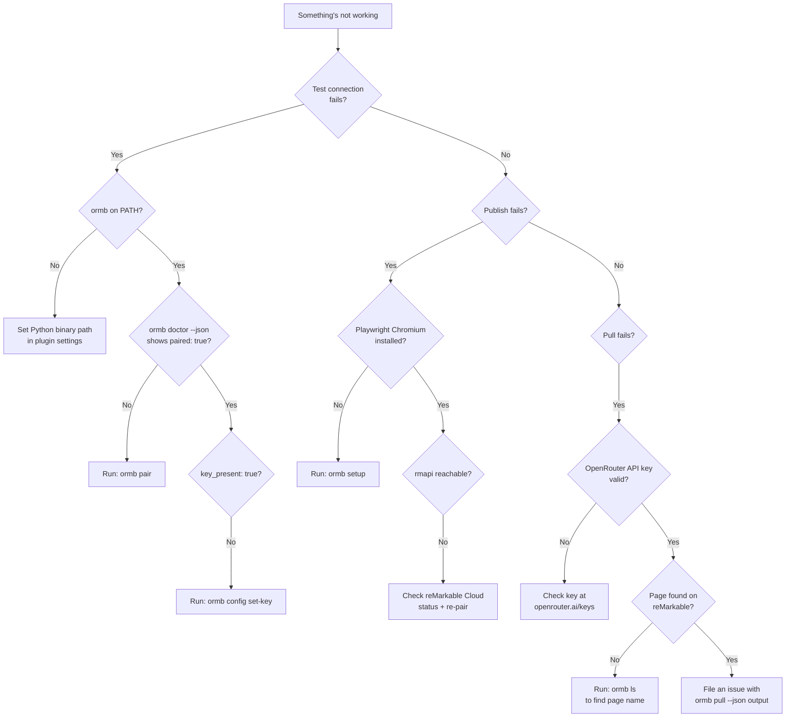

# Troubleshooting

> **Audience:** All users (plugin and CLI)

← Back to [README](../README.md)

## Decision tree



## Common issues

### "ormb: command not found"

The plugin can't find the `ormb` CLI. In the plugin settings tab, set the
**Python binary** path to the full path of your venv's Python, e.g.:
- WSL: `/home/you/remarkable-roundtrip/.venv/bin/python`
- macOS/Linux: `/home/you/remarkable-roundtrip/.venv/bin/python`
- Windows: `C:\dev\remarkable-roundtrip\.venv\Scripts\python.exe`

### "ensurepip not available" (WSL/Ubuntu)

Install the venv package for your Python version:
```bash
sudo apt install python3.10-venv  # adjust to your Python version
```
Then recreate the venv: `python3 -m venv .venv`

### Playwright Chromium install fails

```bash
# Try with system dependencies
ormb setup
# If that fails on Linux:
sudo playwright install-deps
playwright install chromium
```

### "rmapi: not paired" or pairing fails

```bash
# Re-pair
ormb pair
# You'll be prompted to open a URL and enter a code
```

If pairing keeps failing, check that your reMarkable account is active and
you're using the correct device-code URL.

### Pull fails with "page not found"

The page name is the `.md` file stem from when you published, not the
reMarkable document title. Check what's actually on your reMarkable:
```bash
ormb ls
```
Then use the exact name shown.

### Pull fails with OpenRouter error

1. Check your API key: `ormb config show` (key should be present)
2. Check your key is valid at [openrouter.ai/keys](https://openrouter.ai/keys)
3. Check you have credits on your OpenRouter account
4. Check the model is available: `ormb config show` → `vision.model`

### PDF renders but annotations don't appear in the note

1. Make sure you annotated the PDF on the reMarkable and synced
2. Run `ormb pull <page-name>` (the page name is the .md stem)
3. If the source .md is in a subdirectory: `ormb pull <page-name> --md path/to/file.md`
4. Check the consent modal — you must click "Consent & Pull" for the vision call to happen

### "vault not reachable" in doctor

The vault path in your config doesn't exist or isn't accessible:
```bash
ormb config set vault.path /correct/path/to/your/vault
ormb doctor
```

← Back to [README](../README.md)
